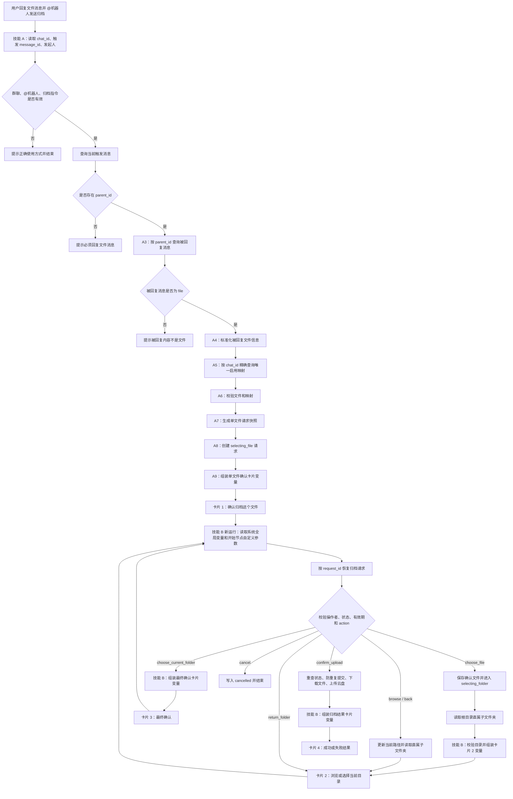

# 飞书 Aily 文件归档应用搭建手册（V2 重搭唯一实施版）

> 本文是当前项目唯一有效的搭建指南，适用于从零重新搭建。
>
> 本版已经删除“读取大量群聊历史、让智能体猜测最终文件”的方案。技能 A 只处理用户明确回复的文件消息；技能 B 是独立技能，每次运行从 Aily 系统全局变量和自己开始节点的自定义参数进入，并通过 `request_id` 从多维表格恢复业务状态。

## 0. 先读结论

### 0.1 用户必须这样发起归档

1. 用户先在群里发送一个文件。
2. 用户对这条文件消息点“回复”。
3. 用户在回复中 @文件归档机器人，并发送“归档”指令。

示例：

```text
回复：项目终版.md
@文件归档机器人 归档这个文件
```

如果用户没有回复文件消息，机器人不猜测最近文件，直接提示：

```text
请回复需要归档的文件消息，并 @机器人发送“归档”。
```

### 0.2 本项目只使用两个技能

| 技能 | 职责 | 结束点 |
|---|---|---|
| 技能 A：发起文件归档 | 识别当前群、取得被回复文件、查询群目录映射、创建请求、发送文件确认卡片 | 卡片 1 发出后结束 |
| 技能 B：处理归档卡片 | 接收每次卡片点击、恢复请求、选择目录、最终确认、上传、返回结果 | 每次处理完当前点击后结束 |

技能 A 不会在原运行现场继续到技能 B。卡片点击会启动一次全新的技能 B。

### 0.3 三条不可违反的规则

1. **即使只有一个文件，也必须先让用户点击卡片确认。**
2. 技能 B 不得引用技能 A 的节点变量；只能读取本次运行的系统全局变量、开始节点自定义参数和多维表格记录。
3. 失败分支必须展示真实节点的 `error`，不得用一条固定文案代替所有错误。

---

## 1. 为什么改成这个方案

### 1.1 2026-07-28 测试失败的真实原因

测试时，多维表格映射查询实际成功：

- `chat_id` 精确命中。
- 返回 `total=1`。
- `enabled=true`。
- 根目录名称、token 和链接均存在。

本次文件是：

```text
PRODUCTION-智能体版.md
```

但映射记录中的 `allowed_file_types` 只有：

```text
pdf, docx, xlsx, pptx, zip
```

因为没有 `md`，文件在类型校验时被过滤。后续失败分支又错误地写死成“当前群没有找到启用的归档目录映射”，导致问题被误判。

重新搭建时必须同时修正：

1. 映射表填写真实需要支持的扩展名；需要归档 Markdown 时必须包含 `md`。
2. 类型不允许时显示“文件类型不允许”，不能显示“没有目录映射”。
3. 任何失败分支都绑定当前节点的真实 `error` 输出。

### 1.2 为什么不再读取群聊历史

测试日志已经证明，触发消息包含：

```text
trigger_message_id
parent_id
root_id
```

且 `parent_id/root_id` 精确指向被回复的文件消息。直接查询这两条消息即可得到：

```text
file_key
file_name
file_message_id
file_sender_open_id
```

因此以下节点全部删除：

- 获取最近 20、30 或更多条群聊消息。
- 将群聊历史交给智能体判断哪个文件是“终版”。
- 从最近 30 分钟消息中扫描候选文件。
- 同时让标准化代码、智能体和 A5 重复寻找文件。

这样可以避免旧卡片、撤回消息、其他机器人消息和历史错误信息污染上下文。

---

## 2. 最终架构



独立流程图源文件：[`ARCHITECTURE_V2.mmd`](./ARCHITECTURE_V2.mmd)。

---

## 3. 推荐搭建顺序

不要先把技能 A 全部搭完。按照下面顺序可以避免回调技能 ID 和参数反复返工。

### 阶段一：准备数据

1. 建立“群目录映射”表。
2. 建立“归档请求”表。
3. 填写一条真实群映射并单独测试查询。

### 阶段二：先搭技能 B 的空入口

1. 新建技能 B。
2. 在开始节点声明四个自定义参数。
3. 临时只连接一个调试输出节点，确认能显示四个参数。
4. 发布技能 B。
5. 记录技能 B 的 `skill_xxx`。

### 阶段三：制作四张卡片

1. 卡片 1：确认文件。
2. 卡片 2：浏览目录。
3. 卡片 3：最终确认。
4. 卡片 4：归档结果。

所有交互卡片的目标技能都指向已发布的技能 B。

### 阶段四：搭技能 A

技能 A 只做到“创建请求并发出卡片 1”。

### 阶段五：逐个补齐技能 B action

按以下顺序测试：

1. `choose_file`
2. `cancel`
3. `choose_current_folder`
4. `browse`
5. `back`
6. `return_folder`
7. `confirm_upload`

不要一次搭完所有分支再测试。

---

## 4. 飞书资源与多维表格

### 4.1 当前资源标识

| 配置项 | 值 |
|---|---|
| Base App Token | `WHaibyXvuaXuJpsDraJcAAM9nIb` |
| 群目录映射 Table ID | `tblacRVYZZ4SJmWW` |
| 启用映射 View ID | `vewPOqHrk9` |
| 归档请求 Table ID | `tblyUgvj29jAL275` |

注意：

- Table ID 只填 `tbl...`。
- View ID 只填 `vew...`。
- 不要把完整多维表格链接填进 Table ID。
- 不要把两张表的 Table ID 填反。

### 4.2 群目录映射表

| 字段 | 建议类型 | 必填 | 说明 |
|---|---|---:|---|
| `mapping_id` | 单行文本 | 是 | 管理编号，例如 `MAP-0001` |
| `chat_id` | 单行文本 | 是 | 群聊 ID，格式通常为 `oc_...` |
| `chat_name` | 单行文本 | 是 | 仅用于展示和排查，不用于主匹配 |
| `root_folder_token` | 单行文本 | 是 | 根目录纯 token |
| `root_folder_name` | 单行文本 | 是 | 根目录展示名称 |
| `root_folder_url` | 超链接 | 是 | 根目录链接 |
| `enabled` | 复选框 | 是 | 只有启用记录可以使用 |
| `allowed_file_types` | 多选 | 是 | 不带点号的小写扩展名 |
| `max_file_size_mb` | 数字 | 是 | 普通上传流程最大只能填 `20` |
| `only_file_sender_can_archive` | 复选框 | 否 | 默认不勾选；勾选后只允许文件发送者本人发起归档 |
| `updated_at` | 日期时间 | 否 | 管理用 |

正确示例：

```text
chat_id                 oc_ef1aa1409f9068ff12c892a42f32e73d
root_folder_token       SDiif2417lQWmidJfFMcDIyXn1e
root_folder_name        测试文件夹
enabled                 true
allowed_file_types      pdf, docx, xlsx, pptx, zip, md
max_file_size_mb        20
only_file_sender_can_archive  false
```

当前流程使用飞书普通上传接口，不支持空文件或超过 20 MB 的文件。需要支持更大文件时，必须另建分片上传流程，不能只把 `max_file_size_mb` 改大。

扩展名规则：

- 写 `md`，不要写 `.md`。
- 全部使用小写。
- 需要支持 Markdown 时必须包含 `md`。
- 空白名单按配置错误处理，不建议解释为“允许全部”。

根目录 token 规则：

```text
正确：SDiif2417lQWmidJfFMcDIyXn1e
错误：https://xxx.feishu.cn/drive/folder/SDiif...?from=...
错误：SDiif...?from=...
```

`chat_name` 可能被修改或出现客户端展示后缀，因此查询只能使用 `chat_id`，不能使用群名称。

### 4.3 映射查询返回值的实际结构

多维表格节点返回的单行文本、超链接和多选字段不是同一种结构。调试时可能看到：

```json
{
  "data": {
    "items": [
      {
        "record_id": "recvpxvxQ61txd",
        "fields": {
          "chat_id": [
            {
              "text": "oc_ef1aa1409f9068ff12c892a42f32e73d",
              "type": "text"
            }
          ],
          "root_folder_name": [
            {
              "text": "测试文件夹",
              "type": "text"
            }
          ],
          "root_folder_url": {
            "link": "https://xxx.feishu.cn/drive/folder/xxx",
            "text": "https://xxx.feishu.cn/drive/folder/xxx",
            "type": "url"
          },
          "allowed_file_types": [
            "pdf",
            "docx",
            "md"
          ],
          "enabled": true
        }
      }
    ],
    "total": 1
  }
}
```

因此标准化节点应分别处理：

| Base 字段形态 | 标准化方式 |
|---|---|
| `[{"text":"xxx","type":"text"}]` | 取第一项 `text` |
| `{"link":"xxx","text":"xxx","type":"url"}` | 链接取 `link` |
| `["pdf","docx","md"]` | 保留为扩展名数组并转小写 |
| `true/false` | 保留布尔值 |

不要因为标准化代码的最终输出字段为空，就反推多维表格没有查到记录。判断映射查询是否成功应直接看：

```text
items 数量
total
record_id
fields.enabled
```

如果平台节点外层还有 `code/data/data/items`，代码节点应接收查询节点的完整输出并逐层解包，直到取得 `items`；不要手工复制一段被截断的 JSON 字符串。

### 4.4 归档请求表

| 字段 | 类型 | 创建时 | 用途 |
|---|---|---|---|
| `request_id` | 单行文本，主字段 | 写入 | 唯一请求编号 |
| `chat_id` | 单行文本 | 写入 | 发起群 |
| `requester_id` | 单行文本 | 写入 | 原发起人 open_id |
| `trigger_message_id` | 单行文本 | 写入 | @机器人指令消息 |
| `candidate_files_json` | 多行文本 | 写入 | 本次唯一文件候选快照 |
| `source_message_id` | 单行文本 | 留空 | 用户确认后写入文件消息 ID |
| `selected_file_id` | 单行文本 | 留空 | 用户确认后写入内部候选 ID |
| `selected_file_key` | 单行文本 | 留空 | 用户确认后写入 file key |
| `selected_file_name` | 单行文本 | 留空 | 用户确认后写入文件名 |
| `selected_file_type` | 单行文本 | 留空 | 用户确认后写入扩展名 |
| `root_folder_token_snapshot` | 单行文本 | 写入 | 请求创建时的根目录 |
| `root_folder_name_snapshot` | 单行文本 | 写入 | 根目录名称 |
| `root_folder_url_snapshot` | 超链接 | 写入 | 根目录链接 |
| `current_folder_token` | 单行文本 | 写入根目录 | 当前浏览目录 |
| `current_folder_name` | 单行文本 | 写入根目录名 | 当前浏览目录名 |
| `current_folder_url` | 超链接 | 写入根目录链接 | 当前浏览目录链接 |
| `folder_path_json` | 多行文本 | 写入根目录路径 | 面包屑和返回上级 |
| `allowed_child_folders_json` | 多行文本 | 写 `[]` | 当前卡片允许进入的直属目录 |
| `target_folder_token` | 单行文本 | 留空 | 最终确认目录 |
| `target_folder_name` | 单行文本 | 留空 | 最终目录名 |
| `target_folder_url` | 超链接 | 留空 | 最终目录链接 |
| `warning_message` | 多行文本 | 按需 | 非阻断提醒 |
| `status` | 单选 | `selecting_file` | 状态机 |
| `expires_at` | 日期时间 | 写入 | 请求过期时间 |
| `confirmed_at` | 日期时间 | 留空 | 最终确认时间 |
| `result_file_token` | 单行文本 | 留空 | 上传结果 token |
| `result_file_url` | 超链接 | 留空 | 上传结果链接 |
| `result_size` | 数字 | 留空 | 上传字节数 |
| `error_message` | 多行文本 | 留空 | 失败原因 |
| `completed_at` | 日期时间 | 留空 | 完成时间 |

状态值固定为：

```text
selecting_file
selecting_folder
waiting_confirm
processing
success
failed
cancelled
expired
```

---

## 5. 技能 B：先配置系统全局变量与开始节点自定义参数

技能名称建议：

```text
处理文件归档卡片-V2
```

### 5.1 先区分两类变量

Aily 开始节点会同时展示两类变量：

| 类型 | 由谁提供 | 本项目用途 |
|---|---|---|
| 系统全局变量 | Aily 自动提供 | `message.sender.openID` 用作卡片点击操作者；`query`、`session`、`channel` 用于上下文 |
| 开始节点自定义参数 | 开发者声明，由卡片回调传入 | `request_id`、`action`、`selected_file_id`、`selected_folder_token` |

不要把四个业务字段理解成“跨技能全局变量”。它们只是技能 B 本次运行的开始节点自定义参数；下一次卡片点击会启动新的技能 B 运行。

### 5.2 B0 开始节点自定义参数

技能 B 的开始节点声明以下自定义参数：

| 参数名 | 类型 | 必填 | 默认值 | 来源 |
|---|---|---:|---|---|
| `request_id` | string | 是 | 空 | 回调对象的 `skill_input` |
| `action` | string | 是 | 空 | 回调对象的 `skill_input` |
| `selected_file_id` | string | 否 | 空 | 卡片 1 回调 |
| `selected_folder_token` | string | 否 | 空 | 卡片 2 表单回调 |

技能 B 的任何后续节点都不得直接引用：

```text
A5.xxx
A8.xxx
技能 A 的用户输入
技能 A 的 chatHistory
上一次技能 B 的节点输出
```

### 5.3 自定义参数的传入方式

固定参数放进按钮 `skill_input`：

```json
{
  "request_id": "archive_xxx",
  "action": "choose_file",
  "selected_file_id": "file_xxx"
}
```

卡片 2 的目录下拉值在用户点击时才产生：

```text
selected_folder_token
```

它必须满足：

1. 卡片表单项标识是 `selected_folder_token`。
2. 技能 B 开始节点存在同名自定义参数。
3. 卡片请求回调将表单值自动传给这个同名自定义参数。

不能只在卡片里创建表单项，却不在技能 B 声明参数。

### 5.4 B0 最小回调测试

正式搭 B 之前，先让开始节点后面只连接一个调试节点，输出：

```json
{
  "request_id": "{{request_id}}",
  "action": "{{action}}",
  "selected_file_id": "{{selected_file_id}}",
  "selected_folder_token": "{{selected_folder_token}}"
}
```

分别点击卡片 1 和卡片 2，预期：

卡片 1：

```json
{
  "request_id": "archive_xxx",
  "action": "choose_file",
  "selected_file_id": "file_xxx",
  "selected_folder_token": ""
}
```

卡片 2“进入选中目录”：

```json
{
  "request_id": "archive_xxx",
  "action": "browse",
  "selected_file_id": "",
  "selected_folder_token": "fldcn_xxx"
}
```

参数没打通之前，不继续搭业务节点。

### 5.5 操作者身份

技能 B 必须从本次卡片点击的系统全局变量取得：

```text
operator_id = message.sender.openID
```

然后把 `operator_id` 传给 `b2_validate_callback.py`，与请求表中的 `requester_id` 比较。

不要接受卡片自行提交的 `operator_open_id` 作为可信身份。卡片参数可以被重放或篡改。

---

## 6. 卡片回调总规则

### 6.1 回调对象结构

交互按钮使用“触发技能”对象，核心字段为：

```json
{
  "x_aily_forbid_forward_callback": true,
  "aily_action": "trigger_skill",
  "skill_id": "skill_xxx",
  "skill_input": "{\"request_id\":\"archive_xxx\",\"action\":\"cancel\"}",
  "update_card": true,
  "success_message": "已取消本次归档"
}
```

规则：

- `skill_id` 必须是已发布技能 B 的 `skill_xxx`。
- 不是应用 ID、卡片模板 ID、节点 ID 或 `cli_xxx`。
- `skill_input` 必须是合法 JSON 字符串，键名必须与技能 B 开始节点自定义参数一致。
- 表单内产生的字段不要重复塞进 `skill_input`；Aily 会按组件名称自动传入。
- 会推进状态的按钮统一使用 `update_card=true`，并填写明确的 `success_message`。
- “发送飞书卡片”节点底部的 HTTP 回调保持为空。
- 本项目没有自建公网回调服务。

### 6.2 卡片编辑器与发送节点的完整绑定步骤

每张交互卡片都按以下顺序配置：

1. 在卡片搭建工具中选中按钮，打开“事件”。
2. 点击时选择“请求回调”。
3. 参数类型选择“对象”。
4. 回传参数选择“绑定变量”。
5. 新建或绑定对应对象变量，例如 `skill_object_choose_file`。
6. 发布卡片。
7. 回到 Aily 的“发送飞书卡片”节点，把卡片对象变量绑定到代码节点同名输出。
8. 调试代码节点，让 Aily 自动解析 `main()` 返回对象结构，再确认所有命名输出均可选。
9. 如果之后重新编辑并发布卡片，必须回到“发送飞书卡片”节点点击“更新”，否则工作流仍可能使用旧卡片版本。

卡片 2 额外要求：下拉框和触发 `browse` 的按钮必须位于同一个表单容器内，下拉组件名称必须是 `selected_folder_token`。

### 6.3 可以通过卡片传什么

允许：

```text
request_id
action
selected_file_id
selected_folder_token
```

不得作为可信状态直接传入：

```text
file_key
source_message_id
root_folder_token
current_folder_name
target_folder_token
文件名
目录名
目录链接
status
requester_id
```

这些真实状态必须通过 `request_id` 从归档请求表恢复。

### 6.4 人员变量

交互卡片统一创建：

```text
变量名：initiator
变量类型：人员
模拟值：{"id":"ou_demo"}
```

人员变量不能创建成普通文本。

---

## 7. 四张卡片

### 7.1 卡片 1：确认文件

卡片名称：

```text
归档-确认文件-V2
```

本方案每次只有一个被明确回复的文件，因此卡片 1 不需要让智能体猜测，也不需要多候选下拉框。

展示内容：

```text
待归档文件：{{file_name}}
文件类型：{{file_type}}
目标根目录：{{root_folder_name}}

是否确认归档此文件？
```

变量：

| 变量 | 类型 | 来源 |
|---|---|---|
| `request_id_text` | 普通文本 | 技能 A 创建的 request_id |
| `file_name` | 普通文本 | 文件消息解析结果 |
| `file_type` | 普通文本 | 文件扩展名 |
| `root_folder_name` | 普通文本 | 映射记录 |
| `initiator` | 人员 | 发起人 open_id |
| `skill_object_choose_file` | 对象 | 技能 A 组装 |
| `skill_object_cancel` | 对象 | 技能 A 组装 |

确认按钮的 `skill_input`：

```json
{
  "request_id": "archive_xxx",
  "action": "choose_file",
  "selected_file_id": "file_xxx"
}
```

取消按钮：

```json
{
  "request_id": "archive_xxx",
  "action": "cancel"
}
```

产品要求：

- 只有一个文件也必须显示本卡片。
- 技能 A 创建请求时不能提前填写 `selected_file_*`。
- 只有用户点击“确认归档此文件”后，技能 B 才写入真实选中文件。
- “确认归档此文件”和“取消”均绑定对象回调，使用 `update_card=true`。
- 确认成功文案建议为“已确认文件，正在加载归档目录…”。

### 7.2 卡片 2：选择目录

卡片名称：

```text
归档-选择目录-V2
```

变量：

| 变量 | 类型 | 来源 |
|---|---|---|
| `selected_file_name` | 普通文本 | 归档请求 |
| `breadcrumb` | 普通文本 | `folder_path_json` |
| `current_folder_url` | 普通文本或链接 | 归档请求 |
| `warning` | 普通文本 | 归档请求 |
| `initiator` | 人员 | 归档请求 requester_id |
| `folder_options` | 选项数组 | 当前目录直属子文件夹 |
| `disable_folder_browse` | 布尔 | 是否没有可进入子目录 |
| `disable_back` | 布尔 | 当前是否为根目录 |
| `skill_object_browse` | 对象 | `action=browse` |
| `skill_object_back` | 对象 | `action=back` |
| `skill_object_choose_current` | 对象 | `action=choose_current_folder` |
| `skill_object_cancel` | 对象 | `action=cancel` |

目录下拉框和“进入选中的文件夹”按钮必须放在同一个表单容器。

| 配置 | 值 |
|---|---|
| 下拉表单项标识 | `selected_folder_token` |
| 选项来源 | `folder_options` |
| 下拉必填 | 是 |
| 提交按钮 action | `browse` |
| 技能 B 同名自定义参数 | `selected_folder_token` |

卡片外部按钮：

- 使用当前目录 → `choose_current_folder`
- 返回上级 → `back`
- 取消 → `cancel`

`browse`、`back`、`choose_current_folder`、`cancel` 均使用 `update_card=true` 和对应的 `success_message`。每次点击后由技能 B 发送一张新卡片 2 或卡片 3，旧卡片不继续承担状态。

空目录时：

- 禁用下拉和“进入”。
- 保留“使用当前目录”。
- 不自动替用户选定目录。

### 7.3 卡片 3：最终确认

卡片名称：

```text
归档-最终确认-V2
```

展示：

```text
文件：{{selected_file_name}}
目标目录：{{target_folder_path}}
目录链接：{{target_folder_url}}

确认后将立即开始上传。
```

按钮：

| 按钮 | action | `update_card` | 建议成功文案 |
|---|---|---:|---|
| 确认上传 | `confirm_upload` | `true` | 已提交归档，正在上传文件… |
| 返回重新选择 | `return_folder` | `true` | 正在返回目录选择… |
| 取消 | `cancel` | `true` | 已取消本次归档 |

卡片 3 不接收文件 key 或目录 token；显示和执行数据都从请求表恢复。

### 7.4 卡片 4：归档结果

卡片名称：

```text
归档-结果-V2
```

展示：

- 成功或失败标题。
- 文件名。
- 目标目录。
- 成功后的文件链接。
- 失败时的可读错误。
- 完成时间。

卡片 4 没有操作按钮，不再触发上传。

---

## 8. 技能 A：从零搭建

技能名称建议：

```text
发起文件归档-V2
```

### A0：开始节点

至少取得：

| 标准变量 | Aily 系统全局变量来源 | 校验 |
|---|---|---|
| `trigger_text` | `query` | 当前用户消息文字 |
| `chat_id` | 优先 `session.sessionID`，也可核对 `channel.larkChannelInfo.chat_id` | 必须为 `oc_...` |
| `trigger_message_id` | `message.channelInfo.message_id` | 必须为 `om_...` |
| `requester_id` | `message.sender.openID` | 必须为 `ou_...` |
| `chat_type` | `session.sessionType` | 必须为 `group` |

第一次调试时打开开始节点上方“变量”，保存真实结构并核对字段大小写。若当前租户版本字段路径有差异，以调试台实际结构为准，但不要改用 `messageHistory` 猜值。

不要把以下值误当成 requester open_id：

- 数字 sender id。
- user_id。
- union_id。
- 机器人 open_id。

### A1：确定性触发判断

不使用智能体节点。

继续条件：

1. `chat_type=group`。
2. 当前消息明确 @了归档机器人。
3. `trigger_text` 包含允许的指令词，例如 `归档`、`存档`。
4. `chat_id`、`trigger_message_id`、`requester_id` 均非空。

不建议只用 `final` 判断归档，因为普通讨论中也可能出现该词。

失败时输出对应原因并结束。

### A2：查询当前触发消息

使用 `trigger_message_id` 查询这条消息本身，不获取整段群聊历史。

需要得到：

```text
message_id
chat_id
parent_id
root_id
sender.id
msg_type
```

校验：

- 返回消息的 `message_id` 等于 `trigger_message_id`。
- 返回消息的 `chat_id` 等于开始节点 `chat_id`。
- 返回消息的发送者等于 `requester_id`。
- `parent_id` 非空。

如果 `parent_id` 为空：

```text
error_code: NOT_REPLY_TO_MESSAGE
error: 请回复需要归档的文件消息，并 @机器人发送“归档”。
```

### A3：查询被回复消息

按触发消息的 `parent_id` 查询被回复消息。

严格规则：

- 被回复消息必须 `msg_type=file`。
- 被回复消息不能已删除或撤回。
- 被回复消息必须与触发消息属于同一个 `chat_id`。
- 默认允许发起人归档群内其他成员发送的文件。
- 只有映射记录 `only_file_sender_can_archive=true` 时，才要求文件发送者与归档发起人相同。

如果 `parent_id` 对应的不是文件，不要继续使用 `root_id` 猜测文件；提示用户直接回复文件消息。

预期文件内容：

```json
{
  "message_id": "om_xxx",
  "msg_type": "file",
  "body": {
    "content": "{\"file_key\":\"file_v3_xxx\",\"file_name\":\"项目终版.md\"}"
  }
}
```

### A4：标准化文件信息

输出：

| 输出 | 说明 |
|---|---|
| `file_message_id` | 被回复文件消息 ID |
| `file_key` | 文件资源 key |
| `file_name` | 文件名 |
| `file_type` | 小写扩展名，不带点 |
| `file_sender_id` | 文件发送者 open_id |
| `file_size` | 能取得则填写，不能取得填 0 |
| `candidate_file_id` | 内部候选 ID |

内部候选 ID 可以由文件消息 ID 派生，但不能使用文件名：

```text
file_<message_id 后若干位>
```

文件名为 `项目终版.md` 时：

```text
file_type = md
```

没有扩展名时按配置错误或不支持类型处理，不要自动猜测。

### A5：查询群目录映射

查询条件只能是：

```text
chat_id is {{A0.chat_id}}
```

建议：

```text
page_size = 2
```

必须区分以下结果：

| 情况 | error_code | 文案 |
|---|---|---|
| 0 条 | `MAPPING_NOT_FOUND` | 当前群未配置归档目录 |
| 大于 1 条 | `MAPPING_DUPLICATED` | 当前群存在重复映射，请管理员处理 |
| `enabled=false` | `MAPPING_DISABLED` | 当前群归档功能未启用 |
| 根 token 为空 | `ROOT_FOLDER_MISSING` | 群目录映射缺少根目录 token |
| 根目录名称为空 | `ROOT_FOLDER_NAME_MISSING` | 群目录映射缺少根目录名称 |
| 根目录链接为空 | `ROOT_FOLDER_URL_MISSING` | 群目录映射缺少根目录链接 |
| 类型白名单为空 | `FILE_TYPE_CONFIG_EMPTY` | 群目录映射未配置允许的文件类型 |

成功后输出：

```text
mapping_record_id
chat_name
root_folder_token
root_folder_name
root_folder_url
allowed_file_types
max_file_size_mb
only_file_sender_can_archive
```

### A6：校验文件

依次校验：

1. `file_key` 非空。
2. `file_name` 非空。
3. `file_type` 在 `allowed_file_types` 中。
4. 能取得文件大小时，不超过 `max_file_size_mb`。
5. 当前普通上传流程要求 `max_file_size_mb` 在 `1..20`；超过 20 直接返回 `FILE_SIZE_CONFIG_UNSUPPORTED`。

类型不允许时必须输出：

```text
error_code: FILE_TYPE_NOT_ALLOWED
error: 当前文件类型 .md 不在本群允许归档的类型中
```

不要输出“没有找到目录映射”。

如果消息查询不能提供文件大小，允许先继续，但在实际下载后必须重新校验真实字节数；空文件或超过 20 MB 的文件停止上传。

### A7：生成请求快照

代码：[`aily_nodes/a7_build_archive_request.py`](./aily_nodes/a7_build_archive_request.py)

该节点接收映射查询、触发消息查询、被回复消息查询的完整输出，同时完成确定性校验和请求快照生成。它不接收群聊历史。

生成：

```text
request_id = archive_<随机唯一值>
status = selecting_file
expires_at = 当前时间 + 30 分钟
```

`candidate_files_json` 即使只有一个文件也保持数组结构：

```json
[
  {
    "id": "file_xxx",
    "file_key": "file_v3_xxx",
    "file_name": "项目终版.md",
    "file_type": "md",
    "message_id": "om_xxx",
    "sender_id": "ou_xxx",
    "file_size": 0,
    "source_type": "replied_message_file"
  }
]
```

`folder_path_json` 初始值：

```json
[
  {
    "token": "根目录token",
    "name": "根目录名称",
    "url": "根目录链接"
  }
]
```

### A8：创建归档请求记录

创建时写入：

| 字段 | 值 |
|---|---|
| `request_id` | A7 request_id |
| `chat_id` | A0 chat_id |
| `requester_id` | A0 requester_id |
| `trigger_message_id` | A0 trigger_message_id |
| `candidate_files_json` | A7 candidate_files_json |
| `root_folder_token_snapshot` | A7 root_folder_token |
| `root_folder_name_snapshot` | A7 root_folder_name |
| `root_folder_url_snapshot` | A7 root_folder_url |
| `current_folder_token` | A7 root_folder_token |
| `current_folder_name` | A7 root_folder_name |
| `current_folder_url` | A7 root_folder_url |
| `folder_path_json` | A7 folder_path_json |
| `allowed_child_folders_json` | `[]` |
| `status` | `selecting_file` |
| `expires_at` | A7 expires_at |

以下字段必须留空：

```text
source_message_id
selected_file_id
selected_file_key
selected_file_name
selected_file_type
target_folder_token
target_folder_name
target_folder_url
```

这条规则保证“只有一个文件也必须先确认”。

### A9：发送卡片 1

代码：[`aily_nodes/a9_build_file_confirm_card.py`](./aily_nodes/a9_build_file_confirm_card.py)

卡片展示 A7 标准化后的文件信息和根目录名称。

确认按钮携带：

```json
{
  "request_id": "A7.request_id",
  "action": "choose_file",
  "selected_file_id": "A7.candidate_file_id"
}
```

取消按钮携带：

```json
{
  "request_id": "A7.request_id",
  "action": "cancel"
}
```

卡片发出后技能 A 结束。

---

## 9. 技能 B：每次点击的固定入口

### B1：校验开始参数

每次运行首先校验：

```text
request_id 非空
action 在允许集合中
```

允许 action：

```text
choose_file
browse
back
choose_current_folder
return_folder
confirm_upload
cancel
```

未知 action 立即结束：

```text
INVALID_ACTION
```

### B2：按 request_id 恢复请求

公共恢复与校验代码：[`aily_nodes/b2_validate_callback.py`](./aily_nodes/b2_validate_callback.py)

查询条件：

```text
request_id is {{B0.request_id}}
```

`page_size=2`，并要求恰好 1 条。

每次都恢复完整记录，不依赖上一次技能运行：

```text
requester_id
candidate_files_json
selected_file_*
source_message_id
root_folder_*_snapshot
current_folder_*
folder_path_json
allowed_child_folders_json
target_folder_*
status
expires_at
```

### B3：公共安全校验

每次 action 前检查：

1. 请求存在且唯一。
2. 请求未过期。
3. 当前操作者等于 `requester_id`。
4. 当前状态允许本次 action。
5. 根路径仍以 `root_folder_token_snapshot` 开始。

action 与状态：

| action | 允许状态 |
|---|---|
| `choose_file` | `selecting_file` |
| `browse` | `selecting_folder` |
| `back` | `selecting_folder` |
| `choose_current_folder` | `selecting_folder` |
| `return_folder` | `waiting_confirm` |
| `confirm_upload` | `waiting_confirm` |
| `cancel` | `selecting_file`、`selecting_folder`、`waiting_confirm` |

终态请求不能再次操作：

```text
processing
success
failed
cancelled
expired
```

---

## 10. 技能 B：action 分支

### 10.1 choose_file

入口参数：

```text
request_id
action=choose_file
selected_file_id
```

步骤：

1. 解析 `candidate_files_json`。
2. 按 `selected_file_id` 查找唯一候选。
3. 不使用卡片提交的文件名或 file key。
4. 从候选快照恢复真实文件信息。
5. 更新请求：

```text
source_message_id
selected_file_id
selected_file_key
selected_file_name
selected_file_type
status = selecting_folder
```

6. 读取根目录直属子文件夹。
7. 保存 `allowed_child_folders_json`。
8. 发送卡片 2。

卡片 2 变量组装代码：[`aily_nodes/b_build_folder_card.py`](./aily_nodes/b_build_folder_card.py)。所有输入都来自技能 B 本次恢复的请求记录和当前目录清单，不来自技能 A。

### 10.2 browse

入口参数：

```text
request_id
action=browse
selected_folder_token
```

步骤：

1. 在 `allowed_child_folders_json` 中查找该 token。
2. 找不到则拒绝，不能直接访问卡片提交的任意 token。
3. 将白名单中的完整目录对象追加到 `folder_path_json`。
4. 更新 `current_folder_token/name/url`。
5. 读取新当前目录的直属子文件夹。
6. 重写 `allowed_child_folders_json`。
7. 发送新的卡片 2。

### 10.3 back

步骤：

1. 解析 `folder_path_json`。
2. 只有根目录一项时禁止返回。
3. 删除最后一项。
4. 使用新的末项更新 `current_folder_token/name/url`。
5. 重新读取直属子文件夹。
6. 发送新的卡片 2。

不得从卡片接收 `parent_folder_token`。

### 10.4 choose_current_folder

步骤：

1. 从请求记录读取 `current_folder_token/name/url`。
2. 写入 `target_folder_token/name/url`。
3. 更新 `status=waiting_confirm`。
4. 用 `folder_path_json` 生成完整面包屑。
5. 发送卡片 3。

卡片 3 变量组装代码：[`aily_nodes/b_build_confirm_card.py`](./aily_nodes/b_build_confirm_card.py)。

### 10.5 return_folder

步骤：

1. 将状态从 `waiting_confirm` 恢复为 `selecting_folder`。
2. 清空 `target_folder_token/name/url`。
3. 重新读取当前目录直属子文件夹。
4. 发送新的卡片 2。

### 10.6 cancel

只允许从可取消状态更新：

```text
status = cancelled
completed_at = 当前时间
```

旧卡片应更新为不可继续操作。

### 10.7 confirm_upload

这是唯一允许执行上传的 action。

步骤：

1. 再次查询最新请求。
2. 确认状态仍为 `waiting_confirm`。
3. 将状态更新为：

```text
waiting_confirm → processing
```

4. 立即再次读取请求；如果已经是终态、存在 `result_file_token`，或状态不是本次预期，停止上传。
5. 从请求记录读取：

```text
source_message_id
selected_file_key
selected_file_name
selected_file_type
target_folder_token
request_id
```

6. 下载消息附件。
7. 按真实下载字节数再次检查：必须大于 0，且不超过映射限制和普通上传接口的 20 MB 上限。
8. 上传到 `target_folder_token`。
9. 成功写入：

```text
status = success
result_file_token
result_file_url
result_size
completed_at
```

10. 失败写入：

```text
status = failed
error_message
completed_at
```

11. 发送卡片 4。

卡片 4 变量组装代码：[`aily_nodes/b_build_result_card.py`](./aily_nodes/b_build_result_card.py)。

这里实现的是“状态校验 + 卡片更新 + 重复点击防护”，不是严格的原子幂等。普通 Base 查询后更新不能被文档描述成已经具备 CAS 抢占；飞书普通上传接口也没有 `request_id` 幂等参数。若业务要求并发条件下绝不产生重复文件，需要另接支持原子条件写或幂等键的服务。

---

## 11. 目录边界与上传

### 11.1 目录清单

每次读取目录时，输入 token 必须来自：

- 请求记录中的 `current_folder_token`；或
- 当前请求保存的 `allowed_child_folders_json` 白名单项。

返回目录项必须满足：

```text
item.parent_token == 本次输入的 current_folder_token
```

不满足时停止发卡片并记录错误，避免误读个人云盘根目录。

### 11.2 下载文件

| 参数 | 来源 |
|---|---|
| 消息 ID | 请求表 `source_message_id` |
| 文件资源 key | 请求表 `selected_file_key` |
| 资源类型 | 固定 `file` |

### 11.3 上传文件

| 参数 | 来源 |
|---|---|
| 文件名 | 请求表 `selected_file_name` |
| 目标目录 | 请求表 `target_folder_token` |
| 文件内容 | 下载节点输出 |
| 文件大小 | 下载后的真实字节数，范围 `1..20 MB` |

不得使用卡片展示文本作为上传输入。
`request_id` 只用于恢复业务状态和排查日志，不是飞书上传接口参数。

---

## 12. 权限、身份与平台限制

正式联调前逐项确认：

### 12.1 群消息权限

- 机器人能力已启用并发布。
- 机器人已经加入触发归档的群。
- 应用已经开通读取消息所需权限；使用应用身份读取群消息时，必须包含群消息读取权限。
- “获取指定消息”节点能用 `message.channelInfo.message_id` 查到触发消息。
- 下载资源时，`source_message_id` 与 `selected_file_key` 必须来自同一条文件消息。

### 12.2 云盘权限

- 先明确“目录清单”和“上传文件”节点使用的是应用身份还是用户身份。
- 根目录必须授权给实际调用身份；只把目录链接写进多维表格不会自动授予权限。
- 调用身份必须对根目录及其子目录具有读取清单和上传文件权限。
- 权限错误、目录不存在、目录映射不存在必须使用不同错误码，不得统一显示“没有目录映射”。

### 12.3 多维表格权限

- 技能 A 能读取“群目录映射”表并创建“归档请求”记录。
- 技能 B 能按 `request_id` 查询和更新“归档请求”记录。
- App Token、Table ID、View ID 使用正确，且调用身份对两张表具有相应权限。

### 12.4 文件大小与接口限制

- 获取消息资源文件的上限高于本项目普通上传上限，但最终瓶颈是普通上传的 20 MB。
- `max_file_size_mb` 只能配置为 `1..20`。
- 下载后再次以真实字节数校验，空文件和超过 20 MB 的文件停止上传。
- 要支持大于 20 MB 的文件，必须另建分片上传流程并单独测试。

---

## 13. 错误处理规范

### 13.1 错误对象

关键校验节点统一输出：

```json
{
  "ok": false,
  "error_code": "FILE_TYPE_NOT_ALLOWED",
  "error": "当前文件类型 .md 不在本群允许归档的类型中"
}
```

成功：

```json
{
  "ok": true,
  "error_code": "",
  "error": ""
}
```

### 13.2 分支配置

每个关键节点后统一：

```text
if ok == true  → 继续
if ok == false → 发送该节点 error → 结束
```

禁止：

- 所有失败都发“没有映射”。
- 忽略代码节点真实 `error`。
- 用空的 `chat_id/root_folder_name` 推断映射没找到。

### 13.3 推荐错误码

```text
INVALID_TRIGGER
TRIGGER_MESSAGE_NOT_FOUND
TRIGGER_MESSAGE_MISMATCH
NOT_REPLY_TO_MESSAGE
REPLIED_MESSAGE_NOT_FILE
FILE_MESSAGE_DELETED
FILE_SENDER_NOT_ALLOWED
MAPPING_NOT_FOUND
MAPPING_DUPLICATED
MAPPING_DISABLED
ROOT_FOLDER_MISSING
ROOT_FOLDER_NAME_MISSING
ROOT_FOLDER_URL_MISSING
FILE_TYPE_CONFIG_EMPTY
FILE_TYPE_NOT_ALLOWED
FILE_SIZE_CONFIG_INVALID
FILE_SIZE_CONFIG_UNSUPPORTED
FILE_TOO_LARGE
CALLBACK_SKILL_ID_MISSING
CALLBACK_SKILL_ID_INVALID
REQUEST_NOT_FOUND
REQUEST_DUPLICATED
REQUEST_EXPIRED
OPERATOR_NOT_ALLOWED
INVALID_ACTION
INVALID_STATUS
INVALID_FILE_SELECTION
INVALID_FOLDER_SELECTION
FOLDER_OUT_OF_BOUNDARY
FOLDER_PARENT_MISSING
DOWNLOAD_FAILED
UPLOAD_FAILED
MESSAGE_PERMISSION_DENIED
FOLDER_PERMISSION_DENIED
```

---

## 14. 不要再添加的节点

本方案不需要：

- 大模型意图分类节点。
- 智能体节点。
- 读取 22 条或更多群聊历史的节点。
- 从最近 30 分钟消息中筛文件的节点。
- “只有一个候选就跳过确认”的条件分支。
- 技能 A 等待技能 B 回调的节点。
- 自建 HTTP 卡片回调节点。

如果平台必须通过技能描述完成路由，可以在技能入口描述中写清“归档文件”，但业务工作流内部仍使用确定性条件判断。

---

## 15. 分阶段联调

### 测试 1：映射查询

输入真实 `chat_id`，预期：

```text
total = 1
enabled = true
root_folder_token 非空
allowed_file_types 包含测试文件扩展名
```

### 测试 2：回复关系

用户直接 @机器人但不回复文件。

预期：

```text
提示必须回复文件消息
不查询历史
不创建请求
```

### 测试 3：文件类型错误

映射不包含 `md`，回复 `.md` 文件。

预期：

```text
FILE_TYPE_NOT_ALLOWED
不显示“没有目录映射”
```

### 测试 4：单文件确认

映射加入 `md` 后重试。

预期：

```text
创建 selecting_file 请求
selected_file_* 全部为空
发送卡片 1
```

### 测试 5：技能 B 开始节点自定义参数

点击卡片 1。

预期技能 B 开始节点收到：

```text
request_id
action=choose_file
selected_file_id
operator_id=message.sender.openID
```

### 测试 6：目录根节点

确认文件后：

```text
status=selecting_folder
current_folder_token=映射根目录
卡片 2 只展示根目录直属子文件夹
```

### 测试 7：最终确认

选择当前目录后：

```text
status=waiting_confirm
卡片 3 正确显示文件和目录
此时尚未上传
```

### 测试 8：重复点击防护

连续点击两次确认上传。

预期：

```text
第一次点击后旧卡片被 update_card 更新
第二次回调若仍到达，状态校验会拒绝非 waiting_confirm 请求
日志中能按 request_id 识别重复提交
```

这项测试验证的是当前低代码流程的防重复能力，不代表已经证明并发条件下严格原子幂等。需要严格保证时，必须接入支持原子条件写或幂等键的服务。

### 测试 9：权限错误

分别移除群消息权限和根目录权限，预期：

```text
群消息权限错误不会显示成没有目录映射
目录权限错误不会显示成没有目录映射
错误信息能定位到消息读取或云盘访问阶段
```

### 测试 10：普通上传大小边界

将 `max_file_size_mb` 配置为 21，预期返回 `FILE_SIZE_CONFIG_UNSUPPORTED`。恢复为 20 后，下载一个超过 20 MB 的文件，预期下载后停止上传。

---

## 16. 最终验收清单

### 技能 A

- [ ] 用户必须直接回复文件消息。
- [ ] 必须 @机器人并包含归档指令。
- [ ] 不读取整段群聊历史。
- [ ] 不使用智能体猜文件。
- [ ] 按当前消息 `parent_id` 精确取得文件。
- [ ] 按 `chat_id` 精确查询映射，不按群名查询。
- [ ] 映射查询 0、1、多条分别处理。
- [ ] 文件类型错误展示真实类型错误。
- [ ] `.md` 测试时白名单包含 `md`。
- [ ] `max_file_size_mb` 在 `1..20`。
- [ ] `only_file_sender_can_archive` 已按产品规则明确配置。
- [ ] 单个文件仍发送卡片 1。
- [ ] 创建请求时所有 `selected_file_*` 均为空。

### 技能 B

- [ ] 开始节点声明四个自定义参数。
- [ ] 每次回调都是一次新的技能 B 运行。
- [ ] 后续节点不引用技能 A 变量。
- [ ] 每次都按 `request_id` 重新查询请求。
- [ ] 操作者固定取 `message.sender.openID`。
- [ ] 文件选择只允许候选快照内部 ID。
- [ ] 目录选择只允许当前子目录白名单。
- [ ] 返回上级不能越过映射根目录。
- [ ] 最终确认前不上传。
- [ ] 上传前重新查询状态并拒绝已处理请求。
- [ ] 已明确当前方案是重复点击防护，不宣称 Base 普通更新具备原子 CAS。

### 卡片与错误

- [ ] 技能 B 已发布并取得正确 `skill_xxx`。
- [ ] 卡片按钮目标技能都是技能 B。
- [ ] `skill_input` 参数名与 B 开始节点自定义参数完全一致。
- [ ] 卡片 2 表单项标识为 `selected_folder_token`。
- [ ] 卡片 2 下拉框和提交按钮位于同一个表单容器。
- [ ] 所有推进状态的按钮使用 `update_card=true` 和明确 `success_message`。
- [ ] 卡片重新发布后，发送卡片节点已经点击“更新”。
- [ ] 根目录已授权给目录和上传节点的实际调用身份。
- [ ] 每个错误分支绑定当前节点真实 `error`。
- [ ] 卡片 4 显示真实结果或可读错误。
- [ ] App Secret 和访问令牌未进入 Base、卡片变量或普通日志。

---

## 17. 当前代码文件

| 文件 | 对应职责 |
|---|---|
| [`aily_nodes/a7_build_archive_request.py`](./aily_nodes/a7_build_archive_request.py) | 技能 A：验证直接回复关系、文件和映射，生成单文件请求快照 |
| [`aily_nodes/a9_build_file_confirm_card.py`](./aily_nodes/a9_build_file_confirm_card.py) | 技能 A：组装单文件确认卡片和技能 B 回调参数 |
| [`aily_nodes/b2_validate_callback.py`](./aily_nodes/b2_validate_callback.py) | 技能 B：验证开始节点自定义参数、恢复请求并校验状态和白名单 |
| [`aily_nodes/b_build_folder_card.py`](./aily_nodes/b_build_folder_card.py) | 技能 B：组装目录浏览卡片 |
| [`aily_nodes/b_build_confirm_card.py`](./aily_nodes/b_build_confirm_card.py) | 技能 B：组装最终确认卡片 |
| [`aily_nodes/b_build_result_card.py`](./aily_nodes/b_build_result_card.py) | 技能 B：组装成功或失败结果卡片 |
| [`tests/test_aily_nodes.py`](./tests/test_aily_nodes.py) | 当前节点合同和关键安全规则测试 |

仓库中不再保留扫描群聊历史的旧 A5，也不再保留多候选下拉卡片的旧 A8。

在 Aily 中复制 Python 代码后，先调试代码节点，让平台自动解析 `main()` 的返回结构；然后确认下游可以选择 `ok`、`error_code`、`error` 以及各卡片对象等命名输出。旧版界面若未自动更新，再使用 JSON 示例手动补齐输出结构，代码返回对象和节点输出类型必须完全一致。
